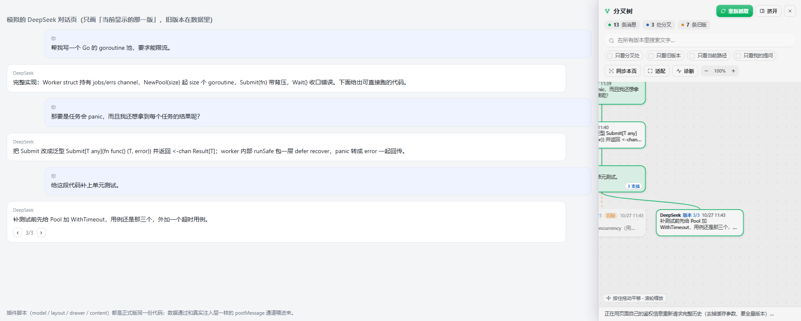

# DeepSeek 分叉树

把 DeepSeek 网页里「重新生成 / 重新编辑」丢掉的那些版本摊成一棵可拖拽、可缩放的树，随时搜、随时翻、随时切回任意一版。

> 非官方扩展，与 DeepSeek 官方无关；只读取页面自己已经拿到的会话历史，不改动、不上传你的任何对话。



## 功能

- **全量版本树**：重新生成、编辑重发产生的隐藏版本都在树上，不是只看当前这一条线。
- **切回任意分支**：点树里任意一版 → 详情里「切到这一版」，插件逐轮核对页面上的 `‹ 2/3 ›` 翻页器，只点 DeepSeek 自己的按钮，把整条对话线切过去（包括被编辑掉的提问带出来的支线）。
- **流式收新版本**：当场点「重新生成」时，流里刚诞生的那一版会直接进树，不用等下次刷新。
- **虚拟滚动适配**：会话很长、页面只保留最近几轮气泡时，会自己向上滚、点「加载更早」，找到并切回旧版。
- **右键菜单**：节点上右键 → 定位到这一版 / 切到这一版 / 复制消息内容 / 复制分支路径。
- **两种铺开方式**：展开时「挤开」页面（默认）或「浮层」盖住页面，随时切换并被记住。
- **可拖动折叠标签**：默认收起，只在右侧留一个标签；标签能贴着屏幕边缘上下拖，位置会被记住。
- **本机缓存**：接口拿不到时回落到 `chrome.storage.local`，长会话最多缓存 1000 条。

## 安装

1. 下载或 `git clone` 本仓库。
2. 打开 `edge://extensions`（Chrome 用 `chrome://extensions`），打开右上角「开发人员模式」。
3. 点「加载解压缩的扩展」，选中本文件夹（含 `manifest.json` 的那一层）。
4. 打开 <https://chat.deepseek.com> 的任意会话，右侧会出现「分叉树」标签。

更新代码后在扩展页点卡片上的 **↻ 重新加载**，再刷新 DeepSeek 页面。

Windows 下也可以双击 `安装-Edge双击加载.cmd`，它会帮你打开扩展页。

## 使用

| 操作 | 说明 |
| --- | --- |
| `Alt` + `D` | 开合抽屉 |
| 点右侧标签 | 展开抽屉；按住可沿屏幕边缘上下拖 |
| 拖动抽屉左边缘 | 改宽度（会被记住） |
| 画布拖动 / 滚轮 | 平移 / 以光标为锚点缩放（不设上下限） |
| 标题栏「挤开 / 浮层」 | 切换展开时是否把页面挤到左边 |
| 节点上右键 | 快捷菜单（定位、切换、复制内容、复制路径） |
| 「诊断」 | 复制一份只含结构的诊断信息，反馈问题时贴出即可 |

滚轮缩到 20% 以下会自动进入全景模式，只留节点色块和分叉线。

## 数据与隐私

- 数据来源是页面自己发出的历史请求，插件在 MAIN world 被动拦截，**只读**。
- 页面那次请求命中本地缓存、只回几百字节时，插件会在约 3 秒后去掉缓存参数、用页面已有登录态**再要一次全量历史**（GET，不改数据）。
- Token、鉴权头只留在注入层内存，不落盘、不进诊断。
- 所有缓存存在本机 `chrome.storage.local`，不联网上报。
- 权限只有 `storage` 与 `https://chat.deepseek.com/*`。

## 已知限制

- 依赖 DeepSeek 网页的 DOM 结构（`ds-message`、哈希类名、`‹ 2/3 ›` 翻页器），对方改版后可能失效。
- 版本是「重新生成 / 编辑重发」产生的分支；普通继续提问仍是一条线。
- 正文为空的消息（如中断、清空回执）会显示成空卡片，不影响结构。

## 开发与验证

无需构建，`src/` 直接加载。离线与真浏览器验证脚本都在 `dev/`：

```bash
node dev/test-model.js     # 树构建 / 解析的离线断言
node dev/cdp-click.js      # 真鼠标：点节点、拖动、跨轮切分支、右键菜单
node dev/cdp-virtual.js    # 真鼠标：虚拟滚动里切回被卸载的旧版
node dev/cdp-sync.js       # 「同步本页」重复并入时不会新增重复节点
node dev/cdp-shell.js      # 默认折叠 / 折叠时热区失效 / 标签拖动 / 挤开与浮层
```

脚本用无头 Edge + CDP 派发真实鼠标事件（合成 `el.click()` 会掩盖指针捕获类失效），各自使用独立端口与临时配置目录。

## 目录

```
src/capture.js   MAIN world：被动拦截 fetch / XHR
src/model.js     解析消息、构建分叉树、判定旧版
src/layout.js    树的布局计算
src/drawer.js    抽屉、画布、卡片、右键菜单、外壳行为
src/drawer.css   抽屉与卡片样式（跟随页面深浅主题）
src/content.js   主流程：同步、重抓、定位、切分支、诊断
dev/             离线 mock 页面与 CDP 验证脚本
docs/            设计与规格文档
```

## License

[MIT](LICENSE)
